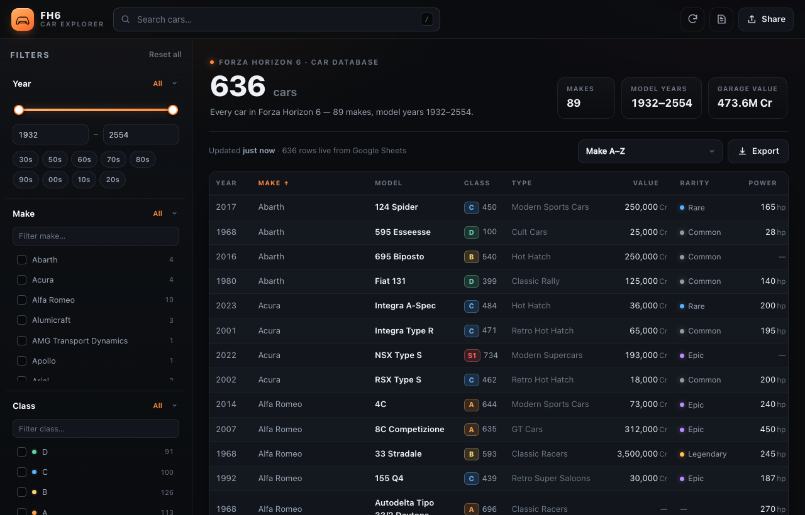
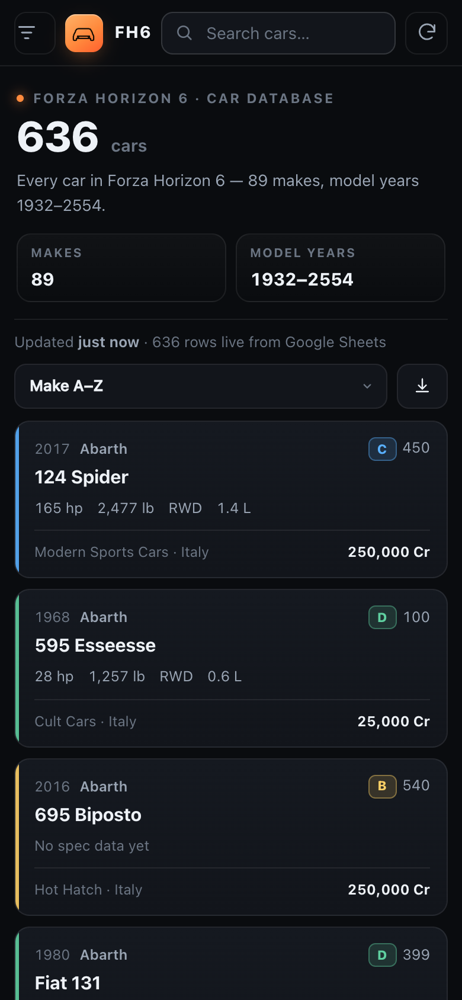

# FH6 Car Explorer

A fast, installable web app for browsing every car in **Forza Horizon 6**. The data
is pulled from the Forza Horizon 6 Car List Google Sheet (add credit). The app is updated as the sheet is updated.

- **Filter by year range** — dual-handle slider, from/to boxes, and decade shortcuts
- **Filter by any column** — multi-select facets for make, class, type, country,
  rarity, drivetrain, engine position, source and more
- **Numeric ranges** — performance index, value, power, weight, torque,
  displacement, lb/hp and the rest
- **Search, sort, share** — searchable, sortable, and every filtered view has its
  own URL you can bookmark or send to your phone
- **Installable PWA** — add it to your home screen and it keeps working offline
  with the last data it downloaded

| Desktop | Phone |
| --- | --- |
|  |  |

## Data source

The app reads this tab of the spreadsheet:

| Workbook | `1G61S4LOaTN2cWMwgbaArtjwTN08M5LJ198bLmsl1guI` |
| --- | --- |
| Tab | **Detailed Car List + Stats** (`gid=1643258561`) |

It uses Google's `gviz` CSV endpoint, which is available for any sheet that is
shared as *"Anyone with the link → Viewer"*. No API key, no backend, no build step.

If you switch tabs, change `CONFIG.sheetId` / `CONFIG.gid` at the top of
[`assets/app.js`](assets/app.js).

## Run locally

```bash
cd forza-car-explorer
python3 -m http.server 8000
```

Open <http://localhost:8000>. A local server is needed because browsers block the
cross-origin read when the page is opened as a `file://` URL.

## Deploy to GitHub Pages

1. Create an empty repository on GitHub, e.g. `fh6-car-explorer`.
2. From this folder:

   ```bash
   git remote add origin https://github.com/<your-username>/fh6-car-explorer.git
   git branch -M main
   git push -u origin main
   ```

3. In the repository, go to **Settings → Pages**.
4. Under **Build and deployment**, choose **Deploy from a branch**, then
   **`main`** and **`/ (root)`**, and save.

The site appears at `https://<your-username>.github.io/fh6-car-explorer/` in a
minute or two. `.nojekyll` is already in place so the files are served as-is.

### Install it on your phone

- **iPhone/iPad** — open the URL in Safari → Share → *Add to Home Screen*.
- **Android** — open it in Chrome → menu → *Install app* / *Add to Home screen*.

## Updating the data

Nothing to do: the sheet is the source of truth. The app fetches fresh data on
every load, checks again every 10 minutes while open, and the refresh button in
the header forces a reload. The last successful download is cached locally, so it
still opens offline and says so in the header.

If the sheet adds a new column, it is picked up automatically: numeric columns
become range filters, short text columns become facets, and everything appears in
the car detail panel.

Tick `Owned?` to `TRUE` on a row and the car gets an **Owned** tag plus an "Owned"
filter appears in the sidebar.

## Project layout

```
index.html               markup
assets/styles.css        styling
assets/app.js            data loading, filtering, rendering
assets/icon*.png|svg     app icons
manifest.webmanifest     PWA manifest
sw.js                    offline app-shell service worker
```

## Notes

- 75 cars have no price and 143 have no spec data in the sheet; they are shown
  with `—` and are excluded only when you narrow that specific range filter.
- The sheet lists the Halo Warthog with model year `2554`, so the year slider
  spans 1932–2554. The decade shortcuts cover 1930s–2020s.
- Unofficial fan project. Forza Horizon is a trademark of Microsoft. Not
  affiliated with Turn 10 Studios or Playground Games.
